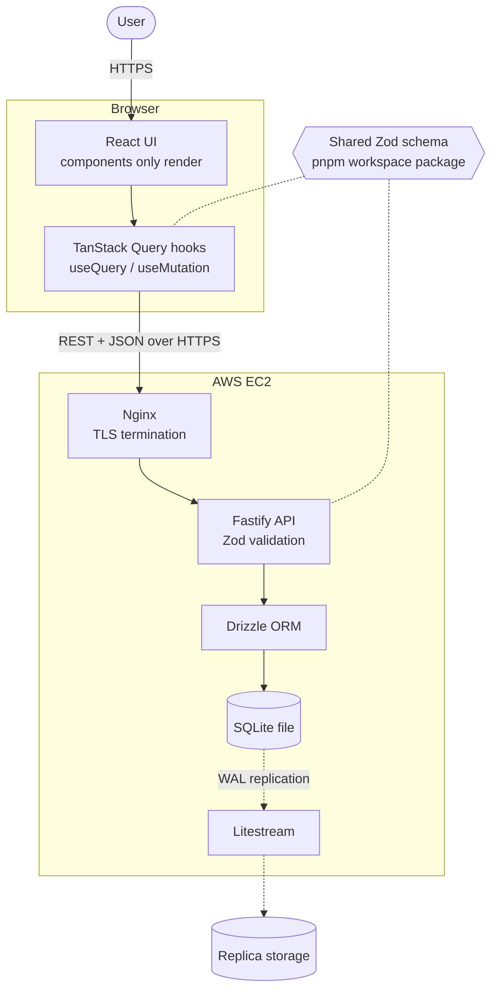
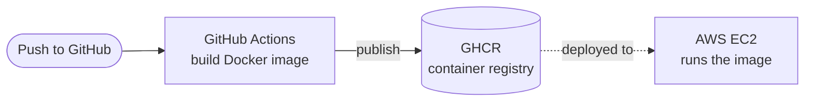

## What it is

Job Tracker is a web app for tracking job applications from wishlist through to an offer or a rejection. Applications show up in two views: a table, and a kanban board of cards grouped by stage. A status filter narrows either view to one stage, and the UI has light and dark themes.

**Live demo:** https://job-tracker-ui-three.vercel.app (seeded mock data; the forms are display-only)
**Full version with the real backend:** this repository

## Why I built it

I was tracking applications in an Excel sheet, and it became hard to manage as it grew. Finding an application, seeing what stage it was in and keeping the sheet consistent all took more effort with every new row. Job Tracker replaces the sheet with a cleaner display and an easier way to update applications as they move between stages.

## Architecture

Design decisions worth knowing:

- **Components only render.** All data access goes through custom hooks built on TanStack Query, with cache invalidation after every change, so the data source can be swapped without touching the UI.
- **One schema for both sides.** A single Zod schema lives in a pnpm workspace package and is used by the API and the React app, so request and response types stay identical.
- **Data survives instance loss.** Litestream continuously replicates the SQLite database off the EC2 instance.

## Delivery pipeline

Every push builds the Docker image and publishes it to GitHub Container Registry.
